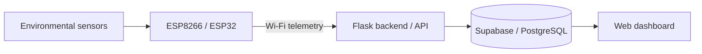

# IoT Weather Station

Real-time weather monitoring with ESP8266/ESP32 sensor nodes, a Flask backend, Supabase (PostgreSQL) storage, and a web dashboard.

**Live demo:** https://gpca-weather-station.onrender.com/
**Built for:** Government Polytechnic College Anantnag, with Muhammad Yaseen

> The dashboard is a live demo. Readings depend on the connected hardware and deployment status. It is not a certified meteorological instrument.

---

## Architecture



## Hardware

| Component | Role |
|---|---|
| ESP8266 / ESP32 | Reads sensors and posts data over Wi-Fi |
| [SENSOR_1, e.g. DHT22] | [temperature / humidity] |
| [SENSOR_2] | [e.g. pressure] |

**Wiring:** see `docs/wiring.png` <!-- TODO: add a wiring diagram or photo -->

## Project structure

```
iot-weather-station/
├── firmware/      # ESP8266/ESP32 sketch
├── backend/       # Flask app
├── dashboard/     # HTML / CSS / JS frontend
└── docs/          # wiring, screenshots
```

<!-- TODO: confirm these folder names match the repo -->

## Setup

### 1. Backend

```bash
git clone https://github.com/yawar2756/iot-weather-station.git
cd iot-weather-station/backend
python -m venv venv
source venv/bin/activate        # Windows: venv\Scripts\activate
pip install -r requirements.txt
```

Create a `.env` file:

```
SUPABASE_URL=your_project_url
SUPABASE_KEY=your_anon_or_service_key
```

Run:

```bash
python app.py
```

### 2. Firmware

1. Open `firmware/` in the Arduino IDE.
2. Install the board package for ESP8266 or ESP32.
3. Set your Wi-Fi SSID, password, and backend URL in the config section.
4. Flash the board.

## API

| Method | Endpoint | Description |
|---|---|---|
| POST | `/api/readings` | [Device posts a reading] |
| GET | `/api/readings` | [Latest readings] |

<!-- TODO: replace with your real endpoints and a sample request/response -->

## Known limitations

- [e.g. No retry if Wi-Fi drops mid-post]
- [e.g. Alerts are dashboard-only, no email/SMS]

## Roadmap

- [ ] [Next feature you actually plan to build]

## Author

**Yawar Nazir Sheikh**
[GitHub](https://github.com/yawar2756) · [LinkedIn](https://www.linkedin.com/in/yawar99/)
